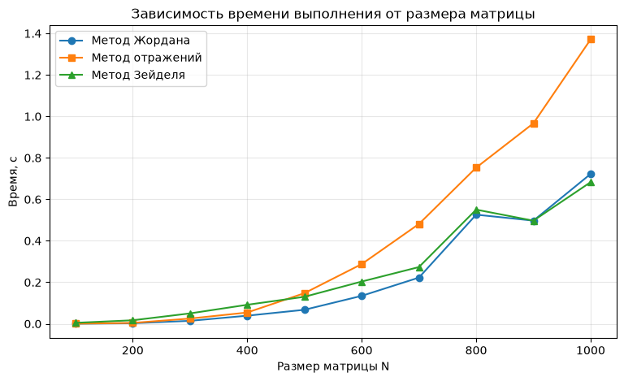
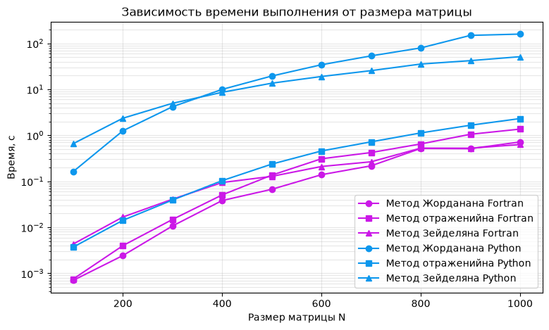
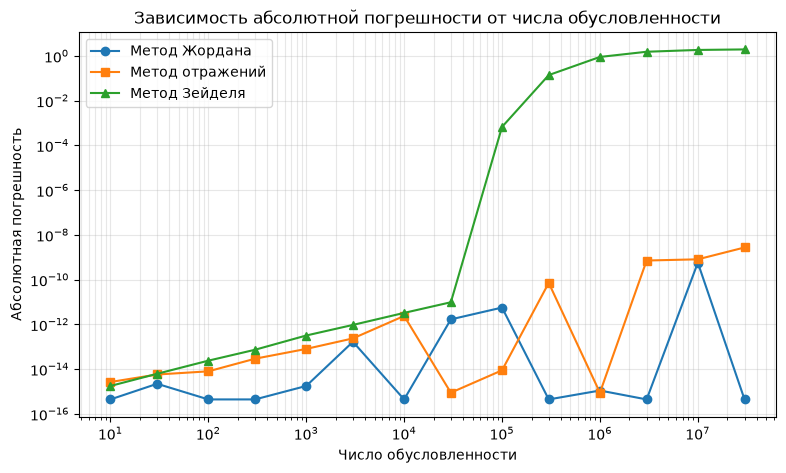
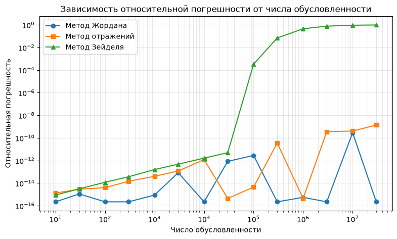
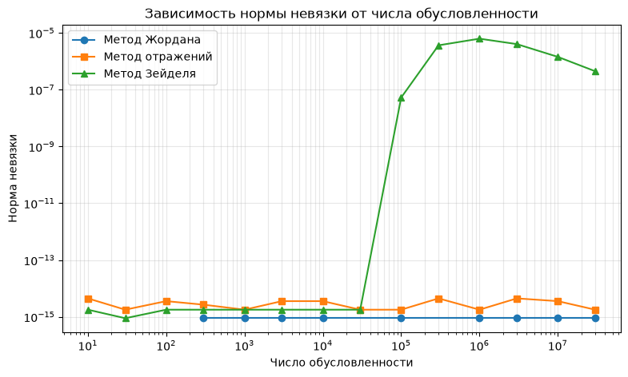
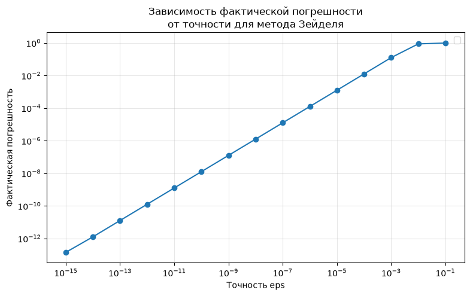

# Research on Methods for Solving Systems of Linear Algebraic Equations
[🇷🇺 Русская версия](README.md)
## Project Description

This project focuses on the study and comparison of numerical methods for solving systems of linear algebraic equations (SLAEs).

Three methods are considered:

- Jordan elimination with partial pivoting by column.
- Householder reflections method.
- Gauss-Seidel method.

The methods are implemented in two programming languages: Python and Fortran. This makes it possible to compare the execution time of the algorithms in different languages and investigate the accuracy of the obtained solutions.

## Project Structure

```text
slau_methods/
├── README.md
├── README.en.md
├── nootebook
│   └── experiment.ipynb
├── reports
│   └── figures
│       ├── time_fortran.png
│       ├── time_languages.png
│       ├── absolute_error.png
│       ├── relative_error.png
│       ├── residual.png
│       └── seidel_eps.png
├── requirements.txt
├── scr
│   ├── __init__.py
│   ├── methods
│   │   ├── __init__.py
│   │   ├── fortran
│   │   │   ├── __init__.py
│   │   │   ├── jordan.f90
│   │   │   ├── reflection.f90
│   │   │   └── seidel.f90
│   │   └── python
│   │       ├── __init__.py
│   │       └── methods.py
│   └── utils
│       ├── __init__.py
│       ├── graphics.py
│       └── matrices.py
└── slau_methods.py
```

## Technologies Used

- Python 3.13
- NumPy
- Matplotlib
- JupyterLab
- Fortran 90/95
- Bash

## Installation and Setup

### 1. Clone the Repository

```bash
git clone <repository-url>
cd slau_methods
```

### 2. Create a Virtual Environment

```bash
python -m venv .venv
```

Activate it in Git Bash:

```bash
source .venv/Scripts/activate
```

### 3. Install Dependencies

```bash
python -m pip install -r requirements.txt
```

### 4. Fortran Setup

To use the Fortran modules, you need to install the gfortran compiler and make sure it is accessible from your system.

This project uses MinGW-w64. The path to the compiler's DLL directory must be available to Python when importing the compiled modules.

If MinGW-w64 is installed in a different location, the corresponding path in the project configuration must be updated.

### 5. Launch JupyterLab

From the project root directory, run:

```bash
python -m jupyter lab
```

After launching JupyterLab, open the `notebooks/experiment.ipynb` notebook to run the experiments.

## Experiments

The project includes five experiments.

### 1. Execution Time vs. Matrix Size

The execution time of the three Fortran implementations is compared for different matrix sizes.

Matrix sizes range from 100 to 1000 with a step of 100.

The condition number of the generated matrices is fixed at 100.

### 2. Execution Time vs. Programming Language

The execution time of the Jordan, Householder reflections, and Gauss-Seidel methods is compared between Python and Fortran implementations.

For each matrix size, the execution time of all six implementations is measured.

This makes it possible to evaluate the influence of the programming language on algorithm performance.

### 3. Absolute and Relative Errors vs. Condition Number

The changes in absolute and relative solution errors are investigated as the condition number of the matrix increases.

For each condition number, a system with a known exact solution is generated.

The results are compared for the three Fortran implementations.

### 4. Residual Norm vs. Condition Number

The change in the residual norm is investigated as the condition number of the matrix increases.

The residual is calculated using the formula: $r = Ax-b.$

The infinity norm of the residual is used for comparison: $\|r\|_\infty = \|Ax-b\|_\infty.$

### 5. Actual Error of the Gauss-Seidel Method vs. Prescribed Accuracy

The influence of the `eps` parameter on the actual relative error of the Gauss-Seidel method is investigated.

The same matrix and right-hand side vector are used for all values of `eps`.

This makes it possible to evaluate how the prescribed accuracy affects the actual accuracy of the computed solution.

## Matrix Generation

The experiments use the `generate_matrix(n, cond)` function from the `scr.utils.matrices` module.

It generates a symmetric block matrix of a specified size with diagonal blocks and a random off-diagonal block.

Function parameters:

- `n` — matrix size;
- `cond` — prescribed condition number.

The following exact solution is used: $x_{\text{exact}} = (2, 2, \ldots, 2)^T$

The right-hand side vector is calculated using the formula: $b = Ax_{\text{exact}}$

## Experimental Results

The experiment plots are saved in the `reports/figures/` directory.

### 1. Execution Time of Fortran Methods



### 2. Execution Time Comparison: Python vs. Fortran



### 3. Absolute Error



### 4. Relative Error



### 5. Residual Norm



### 6. Actual Error of the Gauss-Seidel Method



## Notes

- The same input matrices and right-hand side vectors are used to ensure a fair comparison of the implementations.
- Matrix generation time is excluded from the execution time measurements.
- Fortran module compilation is performed separately and is not included in the algorithm execution time.
- Python and Fortran implementations should use the same algorithms and stopping criteria to ensure a fair comparison.

