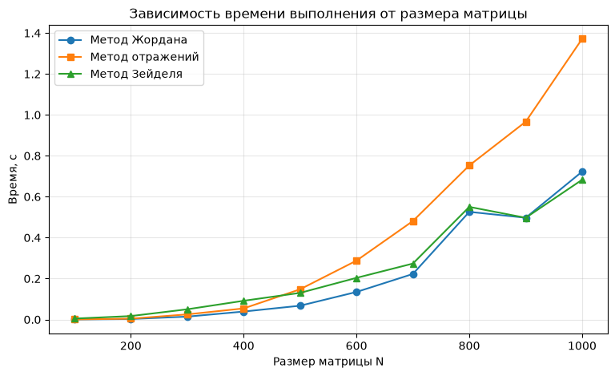
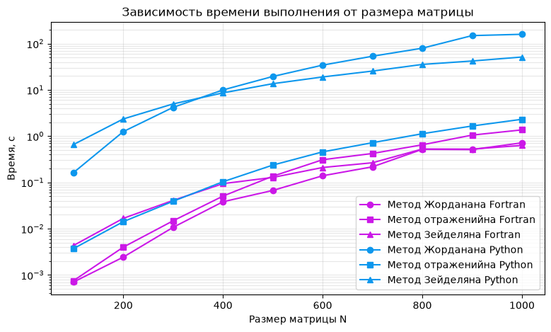
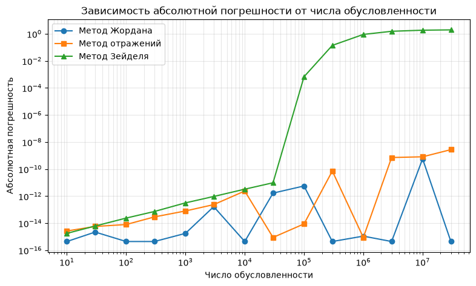
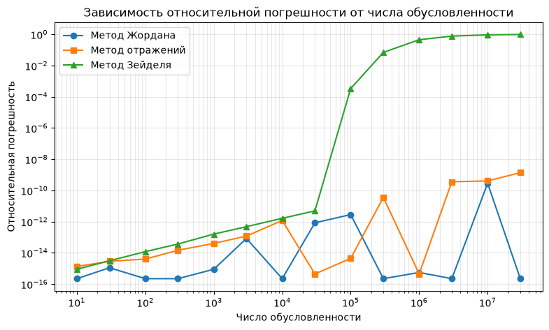
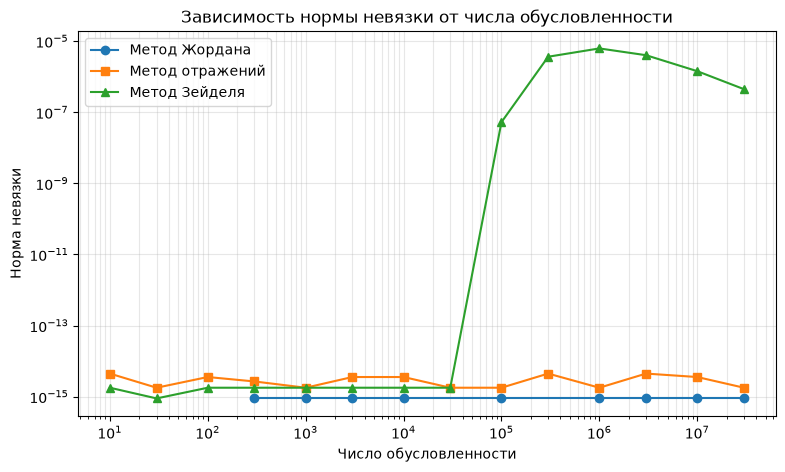
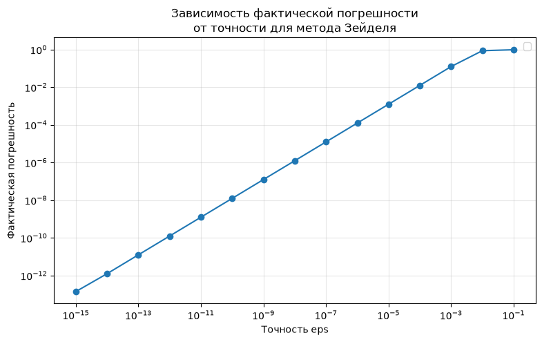

# Исследование методов решения систем линейных алгебраических уравнений
[🇬🇧 English version](README.en.md)
## Описание проекта

Проект посвящён исследованию и сравнению численных методов решения систем линейных алгебраических уравнений (СЛАУ).

Рассматриваются три метода:
- Метод Жордана с выбором главного элемента по столбцу.
- Метод отражений Хаусхолдера.
- Метод Зейделя.

Методы реализованы на двух языках программирования: Python и Fortran. Это позволяет сравнить время выполнения алгоритмов на разных языках, а также исследовать точность получаемых решений.

## Структура проекта

```text
slau_methods/
├── README.md
├── README.en.md
├── nootebook
│   └── experiment.ipynb
├── reports
│   └── figures
│       ├── time_fortran.png
│       ├── time_languages.png
│       ├── absolute_error.png
│       ├── relative_error.png
│       ├── residual.png
│       └── seidel_eps.png
├── requirements.txt
├── scr
│   ├── __init__.py
│   ├── methods
│   │   ├── __init__.py
│   │   ├── fortran
│   │   │   ├── __init__.py
│   │   │   ├── jordan.f90
│   │   │   ├── reflection.f90
│   │   │   └── seidel.f90
│   │   └── python
│   │       ├── __init__.py
│   │       └── methods.py
│   └── utils
│       ├── __init__.py
│       ├── graphics.py
│       └── matrices.py
└── slau_methods.py

```

## Используемые технологии

- Python 3.13
- NumPy
- Matplotlib
- JupyterLab
- Fortran 90/95
- Bash

## Установка и настройка

### 1. Клонирование репозитория

```bash
git clone <ссылка-на-репозиторий>
cd slau_methods
```

### 2. Создание виртуального окружения

```bash
python -m venv .venv
```

Активация в Git Bash:

```bash
source .venv/Scripts/activate
```

### 3. Установка зависимостей

```bash
python -m pip install -r requirements.txt
```

### 4. Настройка Fortran

Для работы Fortran-модулей необходимо установить компилятор gfortran и настроить его доступность в системе.

В проекте используется MinGW-w64. Путь к каталогу с DLL компилятора должен быть доступен Python при импорте скомпилированных модулей.

Если используется другой путь установки MinGW-w64, необходимо изменить соответствующую настройку в проекте.

### 5. Запуск JupyterLab

Из корневой папки проекта:

```bash
python -m jupyter lab
```

После запуска можно открыть ноутбук `notebooks/experiment.ipynb` и выполнять исследования.

## Описание экспериментов

В проекте проводятся пять исследований.

### 1. Зависимость времени выполнения от размера матрицы

Сравнивается время выполнения трёх методов, реализованных на Fortran, при изменении размера матрицы.

Используются размеры от 100 до 1000 с шагом 100.

Число обусловленности генерируемых матриц фиксировано и равно 100.

### 2. Зависимость времени выполнения от языка программирования

Сравнивается время выполнения методов Жордана, отражений Хаусхолдера и Зейделя на Python и Fortran.

Для каждого размера матрицы измеряется время работы всех шести реализаций.

Это позволяет оценить влияние языка программирования на производительность алгоритмов.

### 3. Зависимость абсолютной и относительной погрешностей от числа обусловленности

Исследуется изменение абсолютной и относительной погрешностей решения при увеличении числа обусловленности матрицы.

Для каждого значения числа обусловленности генерируется система с известным точным решением.

Результаты сравниваются для трёх методов, реализованных на Fortran.

### 4. Зависимость нормы невязки от числа обусловленности

Исследуется изменение нормы невязки при увеличении числа обусловленности матрицы.

Невязка вычисляется по формуле: $r = Ax-b.$

Для сравнения используется бесконечная норма невязки: $\|r\|_\infty = \|Ax-b\|_\infty.$


### 5. Зависимость фактической погрешности метода Зейделя от заданной точности

Исследуется влияние параметра `eps` на фактическую относительную погрешность метода Зейделя.

Для всех значений `eps` используется одна и та же матрица и один и тот же вектор правой части.

Это позволяет оценить, насколько заданная точность влияет на фактическую точность полученного решения.

## Генерация матриц

Для проведения экспериментов используется функция `generate_matrix(n, cond)` из модуля `scr.utils.matrices`.

Она формирует симметричную блочную матрицу заданного размера с диагональными блоками и случайным внедиагональным блоком.

Параметры функции:
- `n` — размер матрицы;
- `cond` — задаваемое число обусловленности.

Для формирования вектора правой части используется известное точное решение: $x_{\text{exact}} = (2, 2, \ldots, 2)^T$

Вектор правой части вычисляется по формуле: $b = Ax_{\text{exact}}$


## Результаты исследований

Графики результатов экспериментов сохранены в каталоге `reports/figures/`.

### 1. Время выполнения методов на Fortran



### 2. Сравнение времени выполнения на Python и Fortran



### 3. Абсолютная погрешность



### 4. Относительная погрешность



### 5. Норма невязки



### 6. Фактическая погрешность метода Зейделя



## Примечания

- Для корректного сравнения реализаций используются одинаковые входные матрицы и векторы правой части.
- Время генерации матриц не включается во время выполнения методов.
- Сборка Fortran-модулей выполняется отдельно от измерения времени работы алгоритмов.
- Python-реализации и Fortran-реализации должны использовать одинаковые алгоритмы и критерии остановки, чтобы сравнение было корректным.